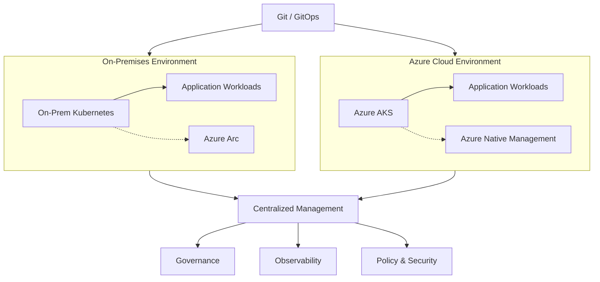
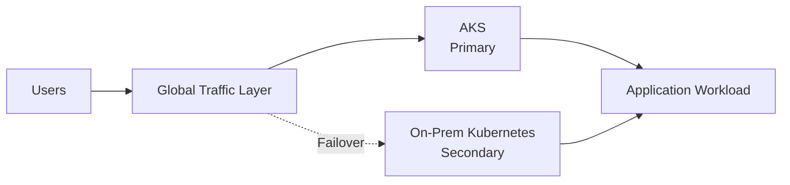
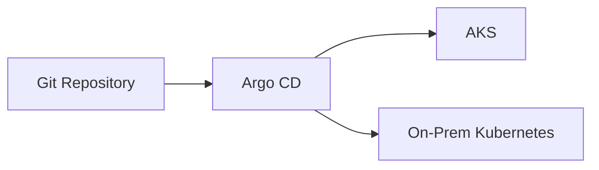
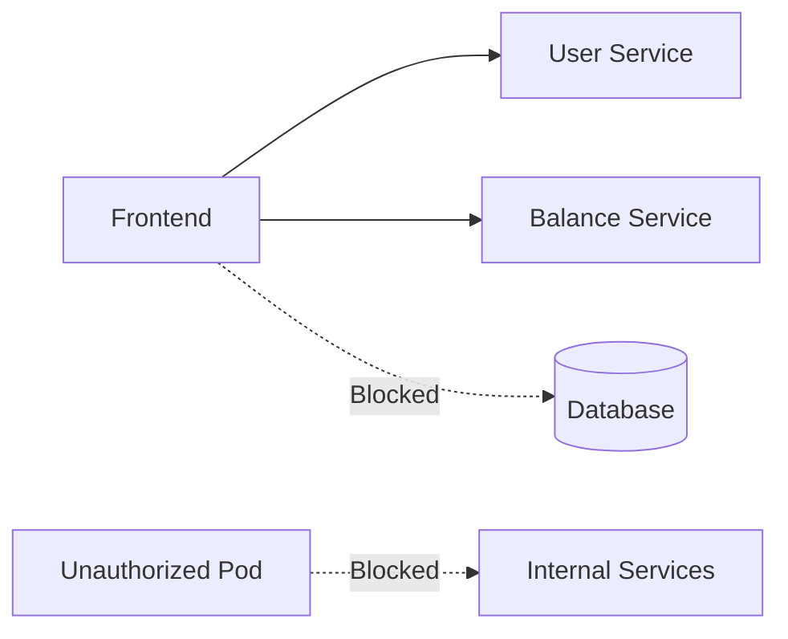

# K8s Nexus | On-Premises · Azure AKS · Azure Arc

Hybrid Kubernetes platform connecting a self-managed [on-premises Kubernetes cluster](https://github.com/mohamedkaba4/Kubernetes-DockingStation) with [Azure Kubernetes Service (AKS)](https://github.com/mohamedkaba4/AKS-Platform).

The infrastructure demonstrates centralized governance, GitOps, workload portability, security controls, observability, and cross-cluster resiliency across cloud and on-prem environments.

Links: 
k8.mavencrest.shop	On-prem Kubernetes storefront
aks.arc.mavencrest.site	Azure AKS storefront
arc.mavencrest.site	Main HA URL — automatic failover
(These links are mainly active when I am either building, testing, or running a demo)

## Architecture

The clusters remain independent Kubernetes environments
while operating under a unified hybrid management model,
with consistent workload deployment, centralized governance,
observability, and security controls.

The clusters remain independent Kubernetes environments while operating under a shared hybrid management model.

## Platform Goals

- Connect self-managed Kubernetes and AKS

- Register the on-prem cluster with Azure Arc

- Apply centralized governance and Azure Policy

- Maintain Kubernetes configuration through GitOps

- Deploy shared workloads across both clusters

- Test active/passive failover scenarios

- Centralize observability and security controls

- Maintain environment-specific configuration where required

## Multi-Cluster Workload Model

The objective is not to merge both environments into one Kubernetes cluster.

Instead, AKS and on-prem Kubernetes operate as independent clusters capable of hosting the same logical workload and supporting cross-cluster resiliency.

## Azure Arc

Azure Arc extends Azure management capabilities to the on-prem Kubernetes cluster.

Key capabilities include:

- Azure Policy

- centralized governance

- cluster inventory

- GitOps integration

- monitoring

- security integration

- consistent management across environments

## GitOps

Git acts as the source of truth for Kubernetes configuration.

Shared configuration can be deployed across both clusters while using separate Helm values or overlays for environment-specific differences.

## High Availability & Failover

The platform is designed to test workload recovery across cloud and on-prem environments.

Planned scenarios include:

- AKS cluster failure

- on-prem cluster failure

- node failure

- application failure

- traffic failover

- configuration drift

- GitOps recovery

- workload redeployment

- database availability

- cross-cluster workload consistency

## Security

Security is a core design focus of K8s Nexus.

The platform will use layered security controls including:

- Kubernetes NetworkPolicy

- Cilium microsegmentation

- least-privilege access

- Azure RBAC

- Azure Policy

- workload identity

- centralized secrets management

- controlled service-to-service communication

- default-deny network policies where appropriate

Microsegmentation is used to limit lateral movement and reduce the blast radius of compromised workloads.

## Platform Stack

| Area | Technologies |

|---|---|

| Kubernetes | AKS, kubeadm |

| Hybrid Management | Azure Arc |

| Infrastructure | Terraform |

| GitOps | Argo CD, Helm |

| Networking | Azure CNI, Cilium, Flannel |

| Security | NetworkPolicy, Azure Policy, Azure RBAC |

| Observability | Prometheus, Grafana |

| CI/CD | GitHub Actions, Azure DevOps |

| Traffic | Cloudflare / Global Traffic Routing |

## Related Platforms

### Mavencrest On-Prem Kubernetes

Self-managed Kubernetes environment focused on:

- kubeadm

- containerd

- worker nodes

- Flannel

- persistent storage

- Cloudflare Tunnel

- Prometheus

- Grafana

- node and workload troubleshooting

### AKS Mavencrest Platform

Azure-hosted Kubernetes platform focused on:

- AKS

- Azure networking

- Azure CNI

- Cilium

- microservices

- Argo CD

- Helm

- autoscaling

- ACR

- workload identity

- observability

- microsegmentation

## Project Objective

K8s Nexus demonstrates the progression from operating independent Kubernetes environments to engineering a hybrid multi-cluster platform spanning on-premises infrastructure and Azure.

The final architecture is designed to show that the same logical workload can be securely deployed, governed, observed, and recovered across both self-managed Kubernetes and AKS.
